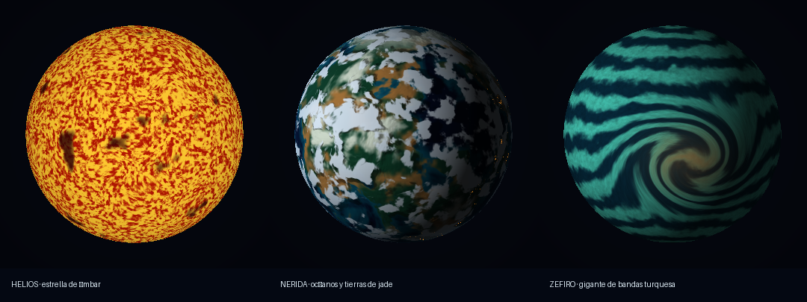
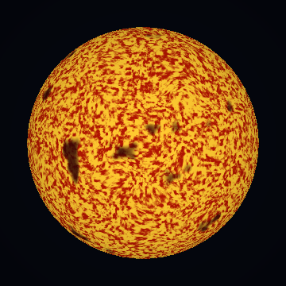
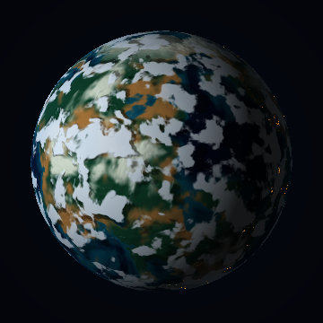
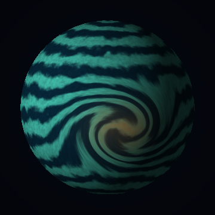

# Laboratorio: planetas y estrellas con shaders en CPU

Tres mundos sobre **la misma esfera**, con rasterización de triángulos en CPU, sin imágenes como texturas ni materiales externos. La apariencia se calcula en `src/shaders.py`; los detalles no desplazan vértices.

> **Adaptación pendiente antes de entregar:** no se adjuntaron el renderer ni la esfera de clase. Se incluyen un renderer propio y una esfera de respaldo. Esta versión funciona, pero no acredita todavía esos dos requisitos particulares. Sigue [ADAPTAR_RENDERER.md](ADAPTAR_RENDERER.md) para integrar los recursos oficiales. Los efectos adicionales no sustituyen ese requisito ni garantizan una nota.



## Instalación y ejecución

Requiere Python 3.10 o posterior. No hay compilación C/C++ ni dependencia de GPU. Internet solo es necesario para instalar las dependencias iniciales.

Abre una terminal **en la carpeta que contiene `main.py`**:

```bash
python -m venv .venv
```

Activa el entorno según tu sistema:

| Sistema | Comando |
|---|---|
| Windows PowerShell | `.venv\Scripts\Activate.ps1` |
| Windows cmd | `.venv\Scripts\activate.bat` |
| macOS / Linux | `source .venv/bin/activate` |

```bash
python -m pip install -r requirements.txt
python main.py
```

En algunos sistemas se usa `python3` en lugar de `python`. La ventana necesita Tkinter, normalmente incluido en Python de python.org. En Debian/Ubuntu se instala con `sudo apt install python3-tk`; en otros sistemas instala el paquete Tk correspondiente a tu Python. La exportación PNG/GIF funciona sin Tk ni escritorio.

La ventana ejecuta los fragment shaders en CPU. Al cambiar la cámara se vuelve a rasterizar la misma malla. Entre cambios de cámara se reutilizan las coordenadas visibles, pero se recalculan los colores para animar los materiales. El rendimiento depende del CPU; usa `python main.py --size 240` si va lento. No se promete tiempo real.

### Controles

| Tecla | Acción |
|---|---|
| `1`, `2`, `3` | Estrella, planeta rocoso, gigante gaseoso |
| Espacio | Pausar/reanudar tiempo del material |
| Izquierda / derecha | Mover cámara alrededor de la esfera |
| Arriba / abajo | Cambiar dirección de luz |
| `C` | Recorrer valores de cobertura de nubes |
| `B` | Activar/desactivar bump mapping del planeta |
| `S` | Guardar `captura.png` en la carpeta del proyecto |
| `R` | Reiniciar cámara, luz y tiempo; conserva parámetros de materiales |
| Escape | Cerrar |

También puedes seleccionar el cuerpo inicial o exportar imágenes sin ventana:

```bash
python main.py --body star
python main.py --body gas
python main.py --body rock --time 1.8 --size 600 --render salida/nerida.png
python main.py --body gas --yaw 0.25 --light -0.7 --render salida/zefiro.png
python main.py --evidence --size 360
python -m unittest discover -s tests -v
```

`--evidence` regenera todas las capturas y GIF en `evidencias/`. Los GIF muestrean instantes y se reproducen de ida y vuelta: su reproducción es ilustrativa y no mide los FPS del programa. Los ángulos se expresan en radianes. `--size` establece ancho y alto entre 64 y 1600 píxeles. Ejecuta `python main.py --help` para ver las opciones.

## Helios: estrella de ámbar



Una superficie cálida, granulada y grumosa, interrumpida por manchas oscuras. Las celdas y filamentos sugieren convección. Su superficie es emisiva: conserva la apariencia aunque cambie la luz externa.

**Implementación:** `src/shaders.py::star_shader`.

Un ruido de baja frecuencia produce tres componentes de deformación. Ese vector perturba las coordenadas de un fBm de mayor frecuencia y crea filamentos irregulares. `smoothstep` convierte el resultado en una máscara suave que mezcla rojo, naranja y amarillo. Otro fBm crea manchas extensas y oscurece zonas seleccionadas. El tiempo desplaza y deforma los campos; la malla permanece inmóvil. Un término dependiente del ángulo de vista oscurece el limbo para reforzar el volumen, sin aplicar luz externa.

| Parámetro en `PARAMS['star']` | Efecto |
|---|---|
| `granule_scale = 38` | Mayor valor: gránulos más pequeños y numerosos |
| `turbulence = 0.65` | Mayor valor: filamentos más deformados |
| `speed = 0.32` | Velocidad del material; cero detiene su evolución |
| `spot_threshold = 0.65` | Mayor valor: menos manchas superan el umbral |

[Animación de Helios](evidencias/star_animacion.gif).

## Nerida: océanos y tierras de jade



Océanos azul petróleo y turquesa, costas suaves, regiones verdes y ocres, casquetes claros y nubes blancas. El agua presenta reflejos; la tierra permanece mate. Pequeñas agrupaciones de luces cálidas aparecen en la noche.

**Implementación:** `src/shaders.py::rock_shader`, `terrain`, `cloud_mask`, `bump_normal`.

1. **Regiones:** un dominio 3D deformado y cinco octavas de fBm generan un campo de altura. Un umbral de nivel del mar separa tierra y agua. Otro ruido controla la sequedad. Altura y latitud añaden picos e hielo.
2. **Iluminación:** la superficie recibe difusión, pero solo el agua recibe un brillo Blinn–Phong según el vector mitad entre vista y luz. El brillo queda restringido al hemisferio iluminado.
3. **Día y noche:** el producto punto entre normal y luz controla una máscara nocturna. Ruido fino, agrupaciones de baja frecuencia y una máscara costera producen luces que se apagan al amanecer. Son detalles pequeños; una exportación de mayor resolución ayuda a inspeccionarlos.
4. **Bump mapping:** diferencias centrales del campo de altura calculan un gradiente. Se elimina su componente radial y se perturba la normal tangente, que después se normaliza. La máscara de tierra limita el relieve; ningún vértice cambia.
5. **Nubes:** otro fBm genera una máscara semitransparente. Solo se rotan sus coordenadas de muestreo con el tiempo. Los continentes conservan sus coordenadas, así que ambas capas tienen velocidades independientes.
6. **Sombras:** un rayo desde el fragmento hacia la luz intersecta una envolvente matemática de radio `1 + cloud_height`. En el punto proyectado se evalúan la **misma máscara de nubes y el mismo tiempo**. Su densidad atenúa la luz sobre el terreno. La dirección de la luz determina el desplazamiento; no se dibuja otra esfera. La sombra se suaviza cerca del terminador.
7. **Bruma:** un término del ángulo de vista colorea el limbo dentro de la silueta existente.

| Parámetro en `PARAMS['rock']` | Efecto |
|---|---|
| `continent_scale = 2.5` | Mayor valor: regiones más pequeñas |
| `sea_level = 0.49` | Mayor valor: más océano |
| `cloud_coverage = 0.52` | Mayor valor: más cobertura nubosa |
| `cloud_speed = 0.13` | Velocidad independiente de nubes |
| `bump_strength = 0.045` | Intensidad de relieve aparente; cero lo desactiva |
| `cloud_height = 0.055` | Separación de sombras respecto de nubes |
| `specular_power = 75` | Mayor valor: brillo del agua más concentrado |
| `city_strength = 1.0` | Intensidad de luces nocturnas |

[Movimiento de nubes](evidencias/rock_animacion.gif) · [Luz móvil, tiempo fijo](evidencias/rock_luz.gif) · [Bump desactivado/activado](evidencias/rock_bump.png).

## Zefiro: gigante de bandas turquesa



Corrientes turquesa y azul oscuro con bordes líquidos, atravesadas por una tormenta cobriza que curva las bandas vecinas.

**Implementación:** `src/shaders.py::gas_coordinates`, `gas_shader`.

La posición local determina longitud y latitud. Alrededor del centro de tormenta se calcula una distancia elíptica; una gaussiana hace que la rotación de coordenadas sea intensa cerca del centro y desaparezca progresivamente lejos de él. Este cambio de dominio curva realmente las bandas, además de colorear la tormenta.

Las coordenadas deformadas vuelven a 3D para consultar ruido sin costura de muestreo en el meridiano. Una sinusoide de latitud, perturbada con fBm, define bandas onduladas. `smoothstep` mezcla sus colores con transiciones suaves. Un ruido fino aporta variaciones internas. Una máscara cálida sigue las bandas deformadas dentro de la tormenta. El tiempo desplaza el ruido y cambia las ondulaciones sin mover la geometría.

| Parámetro en `PARAMS['gas']` | Efecto |
|---|---|
| `band_frequency = 22` | Mayor valor: más bandas |
| `vortex_strength = 3.8` | Intensidad de torsión; cero la elimina |
| `vortex_radius = 0.48` | Extensión angular de región distorsionada |
| `flow_speed = 0.14` | Velocidad de advección del ruido |
| `warp = 0.26` | Irregularidad de transiciones entre bandas |

[Animación de Zefiro](evidencias/gas_animacion.gif).

## Evidencias de efectos adicionales

Lista propuesta para revisión; los puntos dependen del resultado observable y de integrar los recursos obligatorios. No se solicita parallax: cambiar la cámara por sí solo no lo demuestra.

Todas las funciones de la tabla están en **`src/shaders.py`**.

| Efecto | Puntos posibles | Cuerpo y funciones | Evidencia | Parámetro modificable |
|---|---:|---|---|---|
| Material animado | 5 | Helios: `star_shader` | [GIF](evidencias/star_animacion.gif), malla/cámara fijas | `speed`: rapidez de celdas/manchas; no se solicita este criterio por mover nubes |
| Día/noche | 5 | Nerida: `rock_shader` | [GIF de luz](evidencias/rock_luz.gif) | `city_strength`: intensidad de luces costeras visibles de noche |
| Respuestas diferentes a luz | 10 | Nerida: `rock_shader` | [GIF de luz](evidencias/rock_luz.gif) | `specular_power`: concentración del reflejo sobre agua, tierra mate |
| Nubes procedurales | 10 | Nerida: `cloud_mask`, `rock_shader` | [GIF temporal](evidencias/rock_animacion.gif) | `cloud_coverage`, `cloud_speed`: cobertura y movimiento respecto del terreno |
| Vórtice localizado | 10 | Zefiro: `gas_coordinates` | [Captura](evidencias/gas.png), [GIF](evidencias/gas_animacion.gif) | `vortex_strength`, `vortex_radius`: torsión de bandas y alcance |
| Bump mapping | 15 | Nerida: `bump_normal` | [Comparación](evidencias/rock_bump.png), [GIF de luz](evidencias/rock_luz.gif) | `bump_strength`: respuesta de normales, sin cambiar silueta |
| Sombras de nubes | 20 | Nerida: `rock_shader`, `cloud_mask` | [GIF de luz](evidencias/rock_luz.gif), [GIF temporal](evidencias/rock_animacion.gif) | `cloud_height`: desplazamiento de la misma máscara según dirección de luz |

Estos efectos suman **75 puntos adicionales posibles** sobre los 60 básicos; no constituyen una calificación obtenida. La nota final del enunciado tiene un máximo de 100.

## Estructura y límites

| Ruta | Contenido |
|---|---|
| `main.py` | Ventana, argumentos, exportación y generación de evidencias |
| `src/renderer.py` | Rasterización CPU: bounding boxes, baricéntricas, z-buffer |
| `src/mesh.py` | Cargador OBJ y generador de esfera de respaldo |
| `src/noise.py` | Ruido de valor 3D, interpolación, fBm y operaciones comunes |
| `src/shaders.py` | Tres materiales y sus parámetros |
| `assets/sphere.obj` | Una sola esfera para los tres cuerpos |
| `evidencias/` | Capturas y GIF, generados con este renderer |
| `tests/test_render.py` | Cinco pruebas de geometría, materiales, animación, nubes/bump y vórtice |

El ruido es de valor 3D, no OpenSimplex; el enunciado permite ambos. La cámara es ortográfica. La esfera de respaldo tiene radio unitario y centro en el origen, con normales radiales suaves. No hay lunas, anillos, órbitas ni parallax. Las imágenes de evidencia no se cargan para renderizar.

Se comprobaron las exportaciones PNG/GIF y las cinco pruebas automatizadas. La ventana requiere un entorno gráfico local y debe comprobarse allí; la exportación no depende de él.

## Publicar la entrega

1. Integra el renderer y la esfera oficiales siguiendo la guía y actualiza las evidencias.
2. Lee el código y modifica un parámetro de cada material para practicar cómo explicar su resultado.
3. Crea un repositorio en tu cuenta de GitHub y sube el contenido de esta carpeta, incluyendo `assets/` y `evidencias/`. No subas `.venv/` ni cachés.
4. Comprueba la ejecución en un entorno limpio y que el README muestre imágenes y GIF.
5. Entrega el enlace real del repositorio. Este ZIP no crea ni publica uno automáticamente.

Proyecto preparado con apoyo de un LLM. No incluye ni afirma utilizar ejemplos oficiales de clase; esos archivos no se adjuntaron.
